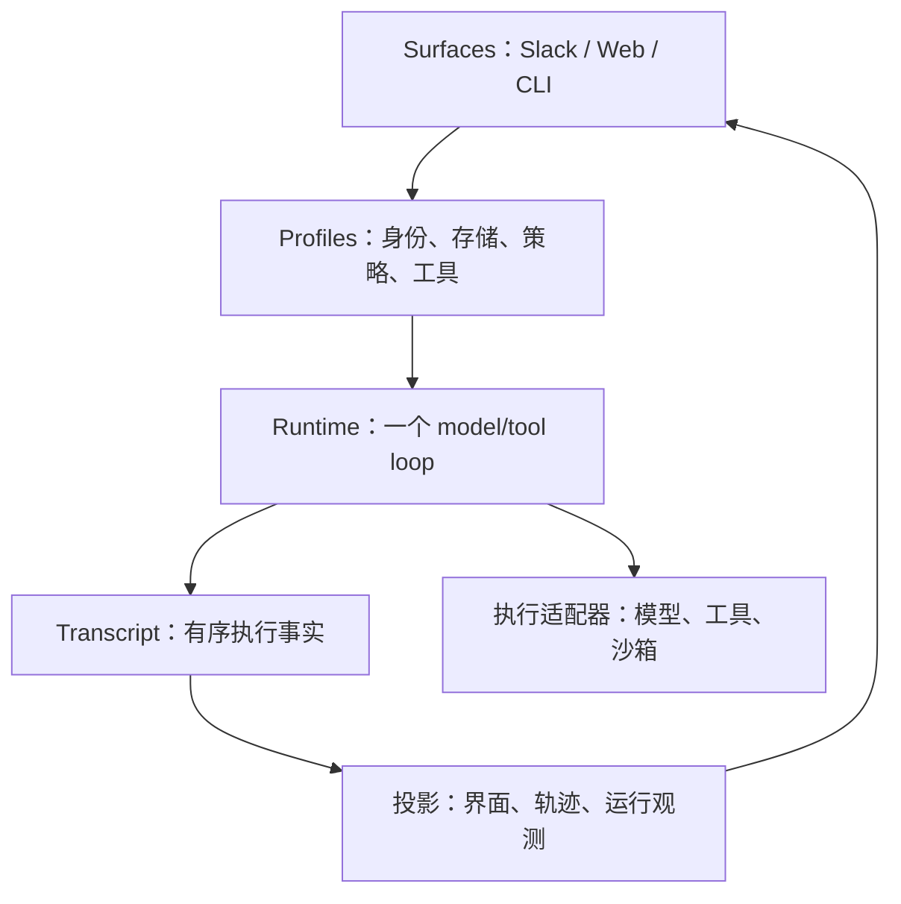
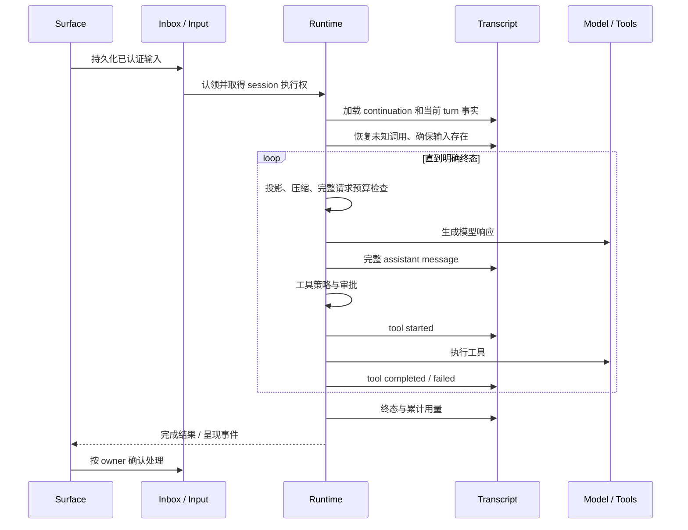

# Kepler 执行架构详解

本文描述本轮实现的执行契约和故障边界。审查修复见 [#12](https://github.com/noknov/kepler-agent/pull/12)，上下文与任务连续性见 [#13](https://github.com/noknov/kepler-agent/pull/13)，执行资源与子任务证据见 [#14](https://github.com/noknov/kepler-agent/pull/14)，记忆生命周期见 [#15](https://github.com/noknov/kepler-agent/pull/15)。四个 PR 独立面向主线；尚未合并的扩展契约仅在对应分支可用。设计方向与尚未完成的能力见
[2026 年审查](agent-audit-2026-10.md)；运维配置见[配置指南](configuration.md)。
这里的“持久化”“恢复”“压缩”“隔离”分别指具体机制，不代表全链路 exactly-once、无损记忆或完全消除提示注入。

## 1. 四层结构与替换边界

`packages/agent` 只依赖规范化的 agent 契约。Slack 签名、HTTP cookie、数据库表名、
provider wire 格式都属于外层适配器。Profile 负责把依赖组装成一个 runtime；它不是另一套 agent loop。

| 边界 | 接收什么 | 必须输出什么 | 不应承担什么 | 实现入口 |
| --- | --- | --- | --- | --- |
| Surface | 经认证的请求和用户输入 | `TurnRequest`、输入队列、呈现事件 | 用 UI 标签授予执行权限 | [surfaces](../packages/surfaces) |
| Profile | 配置、连接、存储和目录 | Model/Policy/Transcript/Lease/Artifacts | 按产品复制模型循环 | [hosted/profile.go](../packages/profiles/hosted/profile.go)、[local](../packages/profiles/local) |
| Runtime | 输入、作用域、依赖 | 完整消息、工具生命周期、明确终态 | 直接访问平台 SDK 或环境凭据 | [runner.go](../packages/agent/runtime/runner.go) |
| Provider | canonical request | canonical response / stream event / typed error | 决定用户授权、持久化业务状态 | [providers](../packages/providers)、[llm](../packages/llm) |
| Tool | 参数、调用 ID、服务端 scope | 结果、错误分类、用量、证据 | 从模型参数替换认证身份 | [tool](../packages/agent/tool)、[tools](../packages/tools) |
| Transcript | 完成的消息与执行事实 | 可重放的有序事件 | 存每个 token delta、充当任务调度器 | [transcript](../packages/agent/transcript) |

当前 hosted 工具与 worker 部署拓扑仍有关联；有接口不等于每次任务已经运行在独立、可替换的远端沙箱。
本地 CLI 与 app-server 共享 runtime，但命令在本机 workspace sandbox 中执行。

## 2. 身份：哪些值由用户选，哪些值只能由服务端提供

| 身份 | 产生位置 | 使用范围 | 错用后果 |
| --- | --- | --- | --- |
| workspace / team + user | Slack 签名事件、Web 认证身份 | 记忆、集成凭据、会话归属 | 跨用户或跨 workspace 读取 |
| session | surface 创建/解析，并验证归属 | 锁、transcript、待处理输入、工具激活 | 两个执行者同时推进同一历史 |
| turn | surface/runtime | 一次执行、审批、预算和终态 | 重试被当成新任务，重复执行 |
| request + attempt | runtime / resilient client | 一次逻辑生成与多次网络尝试 | 把重试计作新的用户任务 |
| tool call + execution ID | provider / runtime | assistant-result 配对、结果复用、下游幂等 | 用结果猜测副作用是否完成 |
| memory generation | memory store | reset 后阻止旧 turn 写回 | 刚删除的记忆被旧审批恢复 |
| artifact reference | runtime 的 artifact store | 当前 session 中的原始大结果 | 把任意路径变成文件读取能力 |

Tool scope 不是模型可填写的参数。`context_read` 从 `call.Scope.SessionID` 读取；
`memory` 使用服务端 `team_id` 和 `UserID`。本地 `artifact_read` 同时校验 URI 中的 session 与调用 scope，
不允许把磁盘路径作为 URI 使用。MCP 会话缓存还绑定 transport、实际 token/headers 指纹与用户/租户作用域。

Runtime 的 session ID 不是认证凭证。外部入口仍须先检查 conversation ownership；不能把知道一个 session ID
视为拥有这个会话。跨 surface 的身份映射由适配器负责，不能直接复用 Slack ID 作为 Web 身份。

## 3. 从收到输入到完成一个 turn

图中的持久队列适用于 hosted 路径；本地 stdio admission 不应被描述为同一套持久入口。
Slack inbox 的去重与 session input 的认领解决“平台投递重复/进程退出”；session lease 解决“谁能推进”；
两者都不把外部 API 调用与数据库提交变成原子事务。

执行起点见 [RunTurn](../packages/agent/runtime/runner.go)。它先取得执行权，再恢复窗口与累计预算，
复用 terminal turn 的结果，恢复原始 authorization scope，然后处理未完成模型/工具请求。
`TurnStarted` 与 `UserInput` 是不同事实：只存在开始标记时，仍必须补齐原始输入。

Steering 在模型/工具轮次之间追加为事件。Queue 是后续执行，Stop 是取消控制；不能把三种输入合成一条
“最后消息”字段，否则无法解释先后顺序、重试和取消。相关实现为
[sessioninput](../packages/sessioninput/store.go)、[Slack service](../packages/surfaces/slack/agent/service.go)、
[Web conversation](../packages/surfaces/web/conversation.go)。

## 4. 执行权、取消与恢复

Hosted 使用 PostgreSQL advisory lock，在独立连接上维持会话所有权；guard 定期检查连接并在失联时取消执行。
本地 CLI/app-server 使用 JSONLStore 的 `.turn.lock` 维持整个 turn 的 OS 文件锁；
`.events.lock` 只保护短暂的事件读写。二者不能共用，否则 turn 持锁后无法提交自己的事件。
进程退出释放 OS lock，但文件内容仍需要 transcript 的恢复规则。

Runtime 内部还有带 context 取消的 session admission。等待者取消时必须及时离开，不应等待前一个长任务完成。
尚未取得执行权的取消只返回 canceled，不写 transcript；已开始的 turn 则记录取消事件。
不同 session 不共用这把执行锁。只读 leaf delegation 使用新建私有 session 和父 context，不重复消耗父进程的
分布式 lease 连接；父子不是同时写同一 transcript。

| 崩溃/超时位置 | 已知事实 | 恢复行为 | 仍不能证明什么 |
| --- | --- | --- | --- |
| 输入已入队，worker 未执行 | durable inbox/input 存在 | 新 owner 重新认领 | 模型曾经收到输入 |
| 有 start，无 user input | turn 已建立 | 按稳定 ID 补齐输入 | start 等于输入提交 |
| assistant 生成了调用，无 tool start | 生成过意图、未记录开始 | 生成 `execution_not_started` 结果 | 该工具已运行 |
| 有 tool start，无结果 | 外部动作可能已发生 | 记录 interrupted/unknown；不自动重发 | 外部动作失败或成功 |
| 工具结果已提交，呈现失败 | 执行事实存在 | 修复投递/投影 | 应再次执行工具 |
| model 有已对用户可见输出后断流 | 用户已见部分内容 | 不从头透明重试 | 流中的片段是最终答案 |
| token 已 reserve，无 settle | 费用未知 | 恢复时保守计入 spent | provider 的实际账单 |
| memory reset 后旧审批完成 | generation 已变化 | 拒绝旧 generation 写入 | transcript 已删除 |

`execution_id` 是可用于下游幂等的稳定身份；只有上游实际接受并执行幂等约束时，才缩小未知副作用窗口。
对于不支持幂等或状态查询的服务，“不重复写”通常比自动修复成功率更优先。

## 5. 四类状态不能混在一起

| 状态 | 权威来源 | 生命周期 | 重建/删除语义 |
| --- | --- | --- | --- |
| 对话与执行事实 | append-only transcript | session 历史 | 压缩不删除原始事件 |
| 当前模型上下文 | projector + checkpoint + ephemeral input | 每次生成 | 可重建、有损、受预算约束 |
| 结构化任务声明 | task_state + source/evidence refs | session 内的任务 | 最新快照独立保留；unknown effect 需显式核对 |
| 用户显式记忆 | `user_memories` + generation | 跨 session | 用户可以清理；不等于清理 transcript |
| 运行/界面状态 | run/step、stream、UI projection | 观测与展示 | 不反向成为执行权限或模型事实 |

`LoadTurn` 提供 checkpoint 之后的 continuation，加上当前 turn 的恢复/计费事实；`Load` 保留完整历史接口。
[sessionEvents](../packages/agent/runtime/session_events.go) 只缓存活跃 turn 的派生视图，append 后增量更新，结束时释放。
本地索引缓存保存 event ID/offset，不保存所有 message body；PostgreSQL 通过条件查询缩小返回窗口。
这些优化减少解码和传输，不能保证任意长度 session 的查询成本严格为常数。

## 6. 上下文如何装配与压缩

每次请求必须满足同一条本地估算约束：

`messages（含 environment 与当前图片） + active tool schemas + output reserve + safety reserve <= context window`

Environment 和当前图片在 projector 内参与预算，不能先检查纯文本 history 再追加。
最后 dispatch 前再次检查完整请求，保护自定义 projector 和特殊恢复路径。
`EstimateTokens` 仍是估算器：图片按固定成本估算，字符/代码按近似规则计数；并不等于 provider tokenizer。

压缩流程见 [context.go](../packages/agent/runtime/context.go)、[projectContext](../packages/agent/runtime/runner.go)：

1. 找到最新有效 checkpoint，只接受向后的显式 coverage；保留当前输入与之后的事件。
2. 组装 system、summary 边界、environment、history、当前输入以及完整工具调用/结果配对。
3. 存在 compactor 时先使用 available input 的 85% 软预算。
4. 超预算时，对近期两个完整 exchange 之外的大 tool result 做 head/tail masking；图片替换为 evidence reference。
5. 仍不足时，按完整 turn/exchange 划分可压缩部分，保护当前输入及未完成工具批次。
6. 把原始已记录证据与读取引用交给 compactor，不拿被 masking 的 preview 当作原文。
7. 将 checkpoint 追加为 `CompactionCreated`，重新投影；有界重试仍不合格则明确失败。
8. 软压缩失败，只在完整 history 仍满足硬预算时继续；不能静默丢掉内容后假装成功。

Checkpoint 的内容包括任务约束、已作决定、验证过的工作、未解决问题、下一步和证据引用。
它是历史数据，以低信任内容处理，不能由摘要里的“系统指令”升级权限。
默认返回文本 checkpoint；可显式启用 Responses 原生窗口，并保留文本 fallback。
结构化 task_state 是独立、带来源和 revision 的模型声明投影；验证边界见[持续执行契约](https://github.com/noknov/kepler-agent/pull/13)。

### 三种证据读取方式

| 机制 | 场景 | 作用域 | 限制 |
| --- | --- | --- | --- |
| `context_read(sequence, block, offset)` | 历史工具结果被 masking/summary 隐藏 | 当前 session | 只读已记录工具 block，不是任意消息全文搜索 |
| hosted `artifact_read(spill://...)` | 大结果保存在 hosted spill store | session + user | 下游存储先验证 scope，再按字节返回 |
| local `artifact_read(artifact://...)` | 大结果在本地 session artifact 目录 | 当前 session | 不暴露 host path；用受限文件根防止文件符号链接越界 |

本地 artifact ID 绑定 turn、文件名和内容摘要，避免不同 turn 复用 call ID 时覆盖旧证据。
读取分页按 UTF-8 边界返回 next offset；读取成本不应随完整 artifact 大小线性增长。
历史版本写出的裸文件路径不是新的 `artifact://` 引用，reader 不接受它们以免扩大文件权限。

若图片在原始 turn 后不持久保留，恢复只能说明“曾经有图片”，不能声称重新看到了原图。
所有“可恢复证据”承诺都必须区分 transcript、spill 和未保存的临时附件。

## 7. 工具发现、执行与 MCP

工具描述解决模型如何调用；effects 决定执行策略；scope 确定身份；catalog exposure 只决定是否可见。
Schema 是调用契约，当前 runtime 并没有一层覆盖所有工具的完整 JSON Schema validator，执行器仍须验证边界值和业务前置条件。

Deferred search 使用 identifier-aware BM25，精确名称激活仍然可用。激活不是授权：runtime 将候选 definitions 和
激活确认结果一起做上下文 admission，失败时保留原目录。中文任务转成英文 capability query 依赖模型，
词法检索不等于语义/多语言检索。

一批工具先完成策略判断，再执行。带写入/privileged effect 的工具不可声明并行；read/network 只有实际语义只读
时才可按 descriptor 并行。所有并行调用受 `MaxParallelToolCalls` 限制，结果按调用顺序持久化。
取消会等待已开始的工具结束并记录结果，避免在仍有副作用执行时先发布终态；不遵守 context 的 executor 仍会拖延结束。

Hosted 的 exact operator allowlist 是第一道写权限。当前 policy 对允许写入继续要求用户批准，
因此“operator allowed”不是“无条件执行”；用户批准也不能添加 operator 未授权的 host 能力。
审批保留原始作用域，reset 后不会取得新的 memory generation。

MCP 支持静态 token 或每次调用 resolver。缓存键使用配置/凭据指纹；凭据变化、租户变化或 TTL 到期需要新 handshake。
旧凭据的迟到失败只能清理它自己的 session。相同 key 的并发初始化合并为一次；等待者可以取消。
该优化不代表自动重发失败的 `tools/call`，尤其不能透明重复未知写入。

Remote `readOnlyHint` 仍是集成声明，不是被验证的实际行为。配置的 MCP server 是信任边界；
执行隔离、出站网络策略和上游凭据范围必须独立成立。

## 8. 并发、用量、成本与公平性

| 机制 | 控制什么 | 不控制什么 |
| --- | --- | --- |
| surface active-turn limit | 本进程接收的活跃工作量 | 集群全局租户公平性 |
| session lock | 同一会话推进权 | 不同会话对同一业务对象的写冲突 |
| tool semaphore | 每轮只读工具并发 | 所有 worker 的全局 HTTP 配额 |
| shared model governor | 实际 attempt 并发、owner/class 轮转与有界排队 | 集群 quota、token/s、优先级抢占 |
| shared token budget | 估算 reserve、用量 settle、恢复后的已用额度 | 精确账单、所有隐藏 retry 的实际收费 |
| circuit breaker | 同样失败的调用/故障 provider 重复消耗 | 判断任务是否完成、证明调用安全 |

父任务不占模型 slot 等待子任务。ResilientClient 对每个实际 attempt 获取 admission，退避释放 slot；
队列按 owner 轮转，owner 内按 interactive/compaction/background 轮转。同类等待者 FIFO。
这是进程内公平调度，不是多副本租户配额；吞吐、尾延迟和成本仍需分别测量。

用量包含 cache/read/create 与 reasoning 的 provider 口径差异。累计 usage、实际 charged spend 和估算 budget 是不同指标。
`ModelUsageSettled` 逐实际 attempt 记录 known usage 与 allowance debit；无 usage 的失败保守扣 reservation。
自定义代理内部不可见的重试与最终金额仍需外部账单核对，不能把逻辑 ModelCompleted usage 再叠加到 receipt 上。

## 9. 记忆生命周期与隐私

Hosted memory 的 identity 是 `(team_id, user_id)`，record 有 semantic key、kind、content、source session/turn、version 和 generation。
自动 recall 在 PostgreSQL 完整 namespace 上融合 trigram 与全文排名，单独限制 preference 注入；可显式启用共享预算内的模型重排。
注入前检查 generation/选中版本，scope enrichment 在 durable input 后执行并记录恢复值。
Memory store 负责 generation fencing、版本 CAS、显式 expiry 和 namespace quota；memory tool 从 authenticated scope 构造 identity。
它尚不是全 namespace embedding semantic recall，检索、迁移和删除边界见[Memory 生命周期](https://github.com/noknov/kepler-agent/pull/15)。

App Home 的清理动作来自签名交互，重试 receipt 避免延迟重放再次删除新记忆。
Reset 清理的是显式 memory 并提升 generation；不清理历史消息、用户规则/skills、连接、日志或第三方 traces。
正在运行任务已经读入的内容也不能从已发送到 provider 的请求中撤回。

| 数据出口 | 当前边界 | 仍需运营约束 |
| --- | --- | --- |
| 模型请求 | policy、敏感路径、最少工具集、低信任边界 | provider retention、任务必要性、集成授权 |
| 用户回复 | surface redactor、结构化公开错误 | 正则不是任意个人信息检测器 |
| 外部遥测内容 | 显式 opt-in、大小/节点限制、字段/token 过滤、递归省略 reasoning/image/artifact URI/native continuation | 出口账号、保留期、访问控制；允许捕获的业务文本仍可能含个人信息 |
| 默认 trace 属性 | session/turn/user 关联 ID | 假名化与跨系统关联需求须由 operator 决定 |
| transcript / spill | 本地权限或 hosted scoped access | 数据清理、备份、加密与删除请求的全生命周期 |

本轮涉及的测试样例已替换为通用组织标识与示例地址；复用 UI 的内部讨论链接被移除，许可证和公开来源保留。
清理当前工作树不改写已发布 Git 历史，也不证明历史提交从未包含敏感信息。

## 10. 修改与验证地图

| 修改范围 | 先阅读 | 必须关注的失败用例 |
| --- | --- | --- |
| 上下文/压缩 | runtime/context、compactor、transcript/checkpoint | 图片、巨大 schema、未完成 tool batch、摘要失败、跨 checkpoint 取证 |
| 生命周期/恢复 | runtime/runner、recovery_progress、session_events | 每个 append 前后退出、重复投递、取消等待、旧 owner |
| 工具与 MCP | runtime/tools、tool/activation、tools/mcp | 凭据轮换、并发初始化、超时后未知副作用、精确 JSON 数值 |
| 存储/本地 | local/store、store_index、session_lease、artifacts | 多 store/process、截断尾部、session 隔离、路径/符号链接 |
| 记忆 | memory/store、query、hosted/hosted、Slack handler | reset 与旧审批竞争、跨用户、版本冲突、分页与低相关命中 |
| 观测与输出 | runtime/langfuse、infra/telemetry、surface events | nested 内容、JSON 文本凭据、部分流、断线、最终消息替换 |

运行仓库规定的 `make check`，对并发变化增加 race 检查，对数据库契约运行真实 PostgreSQL integration cases。
测试通过证明这些场景的回归边界；要证明 agent 能力超过其他产品，还需要同模型/同预算/同任务的真实对照试验。

持续执行的增量实现与数据契约见 [任务状态与原生续接](https://github.com/noknov/kepler-agent/pull/13)。

执行资源、未知副作用和子任务证据的增量契约见[执行资源](https://github.com/noknov/kepler-agent/pull/14)。
