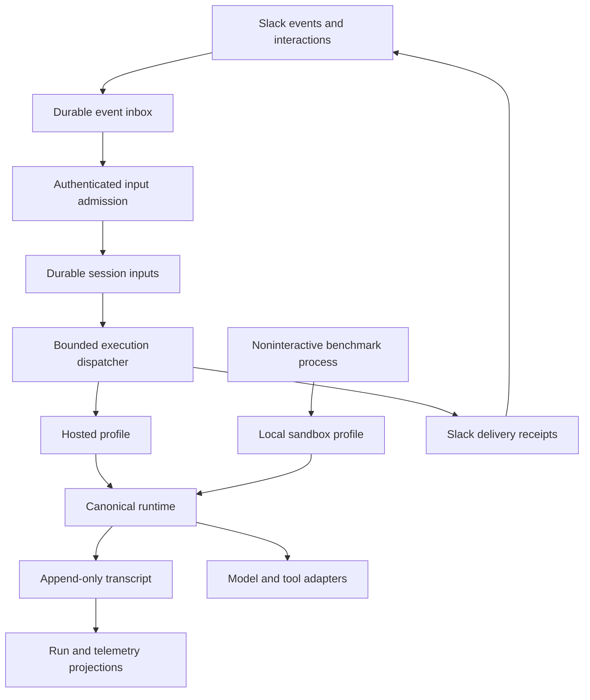

# Architecture

Kepler has one conversational surface, Slack, and one noninteractive benchmark
adapter. Both compose the same transport-neutral runtime. Profiles select tools,
policy, credentials, persistence and providers; they do not implement another loop.

## Ownership

| Owner | Responsibility | Entry |
| --- | --- | --- |
| Slack ingress | Signatures, access and durable event acceptance | [gateway](../gateway/service.go) |
| Slack admission and dispatch | Persist input, route controls, bound execution and drain | [dispatch](../packages/surfaces/slack/agent/dispatch.go) |
| Runtime | Context, model/tool execution, approvals, accounting and terminal facts | [runtime](../packages/agent/runtime) |
| Profiles | Compose storage, policy, models and tool catalogs | [profiles](../packages/profiles) |
| Providers | Translate wire requests and typed events | [providers](../packages/providers) |
| Delivery | Network intent, known Slack identity and status recovery | [delivery](../packages/surfaces/slack/agent/delivery.go) |
| Benchmark | Single-shot input and canonical JSONL output | [benchmark](../benchmark) |
| Delegation | Bounded read-only leaf turns with evidence links | [delegation](../packages/agent/delegation) |

There is no workflow router, automatic PR-review activation, second agent loop,
or persistent autonomous task scheduler. The model chooses tools from the active
catalog. Generic delegation is scoped to the parent turn and is not independent
background work that can outlive or resume after that parent.

## Durable boundaries

Ingress acceptance, session ownership, model completion, external effects,
transcript commit and user delivery are separate facts. PostgreSQL stores hosted
transcripts, event/input queues, connection records and Slack reply receipts.
Redis supplies notifications, not durable acceptance. Run records and Langfuse
traces are observations and cannot authorize a write or prove Slack delivery.

Each execution holds session ownership. Input claims are short and renewed while
work remains owned. Losing a claim cancels the old executor. Failed inputs have
persisted retry deadlines and a bounded attempt budget; exhausted work remains
dead-lettered instead of being acknowledged as success. Shutdown stops admission
of new executions, waits for current ones, then preserves bounded cleanup.

Reply creation records intent before the network call. A known message ID is
retained for repair after restart. An intent without a receipt is uncertain and
must not create another message automatically. Terminal status recovery takes
session ownership and ignores older turns before changing Slack's state.
These mechanisms do not make PostgreSQL and an external API one transaction or
promise exactly-once external effects.

## State and identity

A session identifies a conversation. A turn identifies one execution. A tool
execution ID identifies one attempted effect. The transcript contains completed
messages and execution facts; transient token deltas are presentation only.
Connection identity scopes upstream credentials independently from the user's
Slack identity. Neither a known session ID nor user confirmation grants host
access. Tools use authenticated server scope, not model-supplied actor IDs.

See [runtime](runtime.md), [safety](safety.md), [Slack](slack.md),
[benchmark](benchmark.md), and the [architecture walkthrough](architecture-deep-dive.md).
